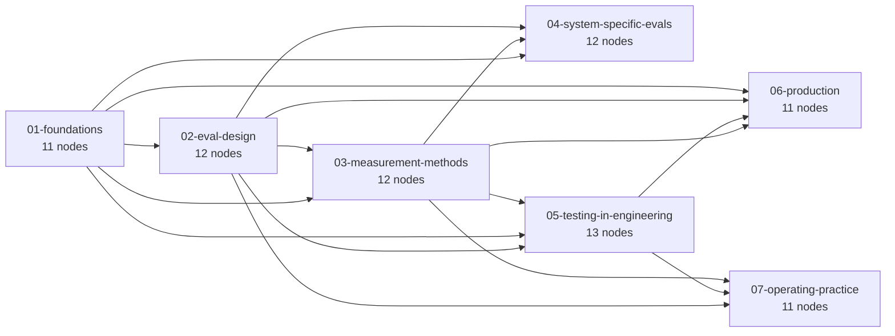
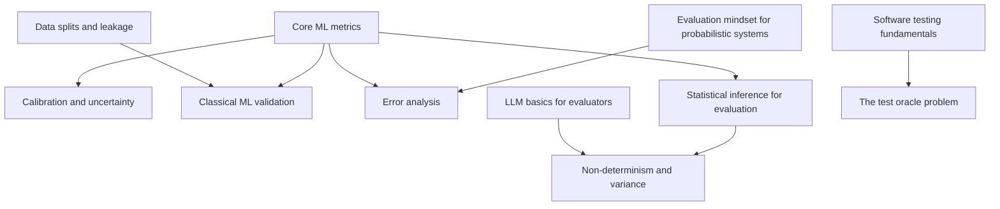
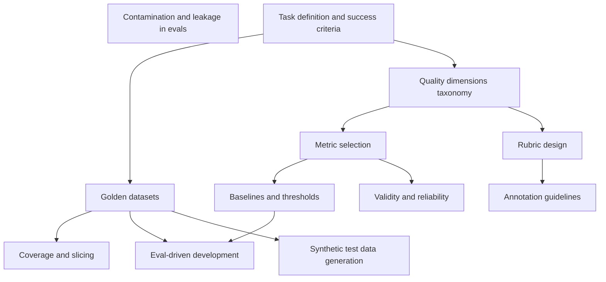
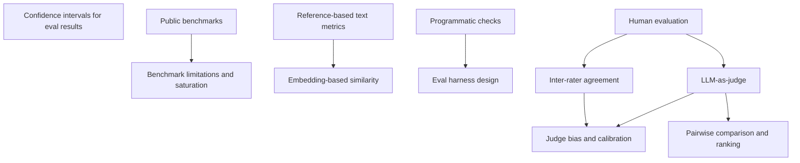
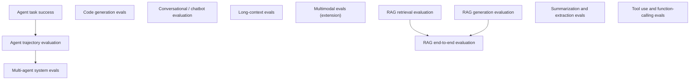
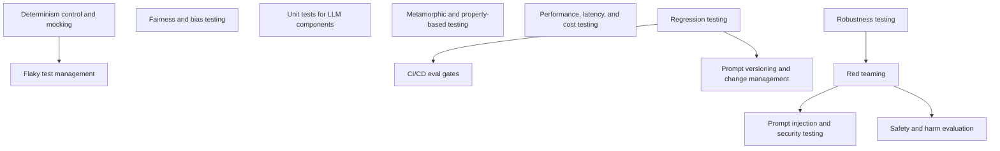
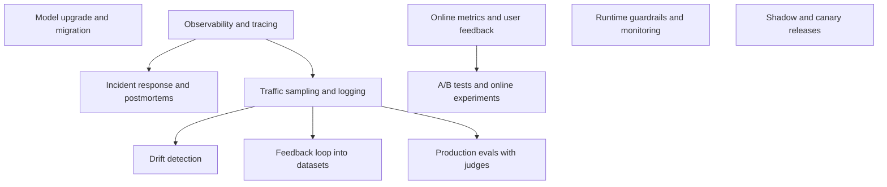
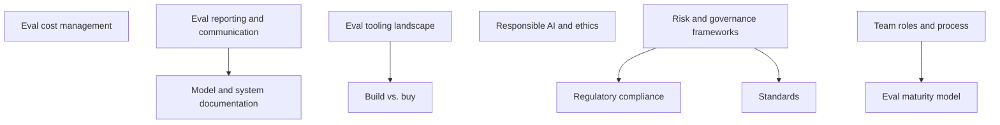

# Map overview

_Generated by `tools/build_views.py`. Do not edit by hand._

## Branch-level view

## 01-foundations

| Node | Depth | Bridge | Cross-branch prerequisites |
|---|---|---|---|
| [Calibration and uncertainty](01-foundations/calibration-and-uncertainty.md) | L2 | stats | - |
| [Classical ML validation](01-foundations/classical-ml-validation.md) | L2 | stats | - |
| [Data splits and leakage](01-foundations/data-splits-and-leakage.md) | L2 | stats | - |
| [Error analysis](01-foundations/error-analysis.md) | L2 | stats | - |
| [Evaluation mindset for probabilistic systems](01-foundations/evaluation-mindset.md) | L1 | none | - |
| [LLM basics for evaluators](01-foundations/llm-basics-for-evaluators.md) | L1 | none | - |
| [Core ML metrics](01-foundations/ml-metrics.md) | L2 | stats | - |
| [Non-determinism and variance](01-foundations/nondeterminism-and-variance.md) | L2 | stats | - |
| [Software testing fundamentals](01-foundations/software-testing-fundamentals.md) | L2 | testing | - |
| [Statistical inference for evaluation](01-foundations/statistical-inference.md) | L2 | stats | - |
| [The test oracle problem](01-foundations/test-oracle-problem.md) | L2 | testing | - |

## 02-eval-design

| Node | Depth | Bridge | Cross-branch prerequisites |
|---|---|---|---|
| [Annotation guidelines](02-eval-design/annotation-guidelines.md) | L2 | none | - |
| [Baselines and thresholds](02-eval-design/baselines-and-thresholds.md) | L2 | testing | - |
| [Contamination and leakage in evals](02-eval-design/contamination-and-leakage.md) | L2 | stats | data-splits-and-leakage |
| [Coverage and slicing](02-eval-design/coverage-and-slicing.md) | L2 | testing | - |
| [Eval-driven development](02-eval-design/eval-driven-development.md) | L2 | testing | - |
| [Golden datasets](02-eval-design/golden-datasets.md) | L2 | none | - |
| [Metric selection](02-eval-design/metric-selection.md) | L2 | stats | ml-metrics |
| [Quality dimensions taxonomy](02-eval-design/quality-dimensions-taxonomy.md) | L2 | none | - |
| [Rubric design](02-eval-design/rubric-design.md) | L2 | none | - |
| [Synthetic test data generation](02-eval-design/synthetic-data-generation.md) | L2 | none | - |
| [Task definition and success criteria](02-eval-design/task-definition-and-success-criteria.md) | L2 | none | evaluation-mindset |
| [Validity and reliability](02-eval-design/validity-and-reliability.md) | L3 | stats | - |

## 03-measurement-methods

| Node | Depth | Bridge | Cross-branch prerequisites |
|---|---|---|---|
| [Benchmark limitations and saturation](03-measurement-methods/benchmark-limitations.md) | L3 | none | contamination-and-leakage |
| [Confidence intervals for eval results](03-measurement-methods/confidence-intervals-for-evals.md) | L2 | stats | statistical-inference, nondeterminism-and-variance |
| [Embedding-based similarity](03-measurement-methods/embedding-similarity-metrics.md) | L2 | stats | - |
| [Eval harness design](03-measurement-methods/eval-harness-design.md) | L2 | testing | - |
| [Human evaluation](03-measurement-methods/human-evaluation.md) | L2 | none | rubric-design, annotation-guidelines |
| [Inter-rater agreement](03-measurement-methods/inter-rater-agreement.md) | L2 | stats | statistical-inference |
| [Judge bias and calibration](03-measurement-methods/judge-bias-and-calibration.md) | L3 | stats | - |
| [LLM-as-judge](03-measurement-methods/llm-as-judge.md) | L2 | none | rubric-design |
| [Pairwise comparison and ranking](03-measurement-methods/pairwise-comparison-and-ranking.md) | L2 | stats | statistical-inference |
| [Programmatic checks](03-measurement-methods/programmatic-checks.md) | L2 | testing | test-oracle-problem |
| [Public benchmarks](03-measurement-methods/public-benchmarks.md) | L2 | none | metric-selection |
| [Reference-based text metrics](03-measurement-methods/reference-based-metrics.md) | L2 | stats | ml-metrics |

## 04-system-specific-evals

| Node | Depth | Bridge | Cross-branch prerequisites |
|---|---|---|---|
| [Agent task success](04-system-specific-evals/agent-task-success-evals.md) | L2 | none | task-definition-and-success-criteria |
| [Agent trajectory evaluation](04-system-specific-evals/agent-trajectory-evals.md) | L3 | none | - |
| [Code generation evals](04-system-specific-evals/code-generation-evals.md) | L2 | testing | programmatic-checks |
| [Conversational / chatbot evaluation](04-system-specific-evals/conversational-evals.md) | L2 | none | llm-as-judge |
| [Long-context evals](04-system-specific-evals/long-context-evals.md) | L3 | none | llm-basics-for-evaluators |
| [Multi-agent system evals](04-system-specific-evals/multi-agent-evals.md) | L3 | none | - |
| [Multimodal evals (extension)](04-system-specific-evals/multimodal-evals.md) | L1 | none | metric-selection |
| [RAG end-to-end evaluation](04-system-specific-evals/rag-end-to-end-evals.md) | L3 | none | - |
| [RAG generation evaluation](04-system-specific-evals/rag-generation-evals.md) | L2 | none | llm-as-judge |
| [RAG retrieval evaluation](04-system-specific-evals/rag-retrieval-evals.md) | L2 | stats | metric-selection |
| [Summarization and extraction evals](04-system-specific-evals/summarization-and-extraction-evals.md) | L2 | none | reference-based-metrics, llm-as-judge |
| [Tool use and function-calling evals](04-system-specific-evals/tool-use-evals.md) | L2 | testing | programmatic-checks |

## 05-testing-in-engineering

| Node | Depth | Bridge | Cross-branch prerequisites |
|---|---|---|---|
| [CI/CD eval gates](05-testing-in-engineering/ci-eval-gates.md) | L2 | testing | eval-harness-design |
| [Determinism control and mocking](05-testing-in-engineering/determinism-control-and-mocking.md) | L2 | testing | nondeterminism-and-variance |
| [Fairness and bias testing](05-testing-in-engineering/fairness-and-bias-testing.md) | L3 | stats | coverage-and-slicing |
| [Flaky test management](05-testing-in-engineering/flaky-test-management.md) | L2 | testing | confidence-intervals-for-evals |
| [Unit tests for LLM components](05-testing-in-engineering/llm-unit-tests.md) | L2 | testing | software-testing-fundamentals, programmatic-checks |
| [Metamorphic and property-based testing](05-testing-in-engineering/metamorphic-and-property-testing.md) | L3 | testing | test-oracle-problem |
| [Performance, latency, and cost testing](05-testing-in-engineering/performance-latency-cost-testing.md) | L2 | testing | software-testing-fundamentals |
| [Prompt injection and security testing](05-testing-in-engineering/prompt-injection-security-testing.md) | L3 | testing | - |
| [Prompt versioning and change management](05-testing-in-engineering/prompt-versioning-and-change-management.md) | L2 | testing | - |
| [Red teaming](05-testing-in-engineering/red-teaming.md) | L3 | testing | - |
| [Regression testing](05-testing-in-engineering/regression-testing.md) | L2 | testing | golden-datasets, baselines-and-thresholds |
| [Robustness testing](05-testing-in-engineering/robustness-testing.md) | L2 | testing | coverage-and-slicing |
| [Safety and harm evaluation](05-testing-in-engineering/safety-and-harm-evals.md) | L3 | none | rubric-design |

## 06-production

| Node | Depth | Bridge | Cross-branch prerequisites |
|---|---|---|---|
| [Drift detection](06-production/drift-detection.md) | L2 | stats | classical-ml-validation |
| [Feedback loop into datasets](06-production/feedback-loop-to-datasets.md) | L2 | none | golden-datasets |
| [Incident response and postmortems](06-production/incident-response-and-postmortems.md) | L2 | testing | - |
| [Model upgrade and migration](06-production/model-upgrade-and-migration.md) | L2 | testing | regression-testing |
| [Observability and tracing](06-production/observability-and-tracing.md) | L2 | testing | eval-harness-design |
| [A/B tests and online experiments](06-production/online-experiments.md) | L2 | stats | statistical-inference |
| [Online metrics and user feedback](06-production/online-metrics-and-user-feedback.md) | L2 | none | metric-selection |
| [Production evals with judges](06-production/production-evals-with-judges.md) | L2 | none | llm-as-judge |
| [Runtime guardrails and monitoring](06-production/runtime-guardrails.md) | L2 | testing | safety-and-harm-evals |
| [Shadow and canary releases](06-production/shadow-and-canary-releases.md) | L2 | testing | ci-eval-gates |
| [Traffic sampling and logging](06-production/traffic-sampling-and-logging.md) | L2 | none | - |

## 07-operating-practice

| Node | Depth | Bridge | Cross-branch prerequisites |
|---|---|---|---|
| [Build vs. buy](07-operating-practice/build-vs-buy.md) | L2 | none | - |
| [Eval cost management](07-operating-practice/eval-cost-management.md) | L2 | none | llm-as-judge |
| [Eval maturity model](07-operating-practice/eval-maturity-model.md) | L3 | none | - |
| [Eval reporting and communication](07-operating-practice/eval-reporting-and-communication.md) | L2 | none | confidence-intervals-for-evals |
| [Eval tooling landscape](07-operating-practice/eval-tooling-landscape.md) | L1 | none | eval-harness-design |
| [Model and system documentation](07-operating-practice/model-and-system-documentation.md) | L2 | none | - |
| [Regulatory compliance](07-operating-practice/regulatory-compliance.md) | L2 | none | - |
| [Responsible AI and ethics](07-operating-practice/responsible-ai-ethics.md) | L2 | none | fairness-and-bias-testing |
| [Risk and governance frameworks](07-operating-practice/risk-and-governance-frameworks.md) | L2 | none | safety-and-harm-evals |
| [Standards](07-operating-practice/standards.md) | L2 | none | - |
| [Team roles and process](07-operating-practice/team-roles-and-process.md) | L2 | none | eval-driven-development |
